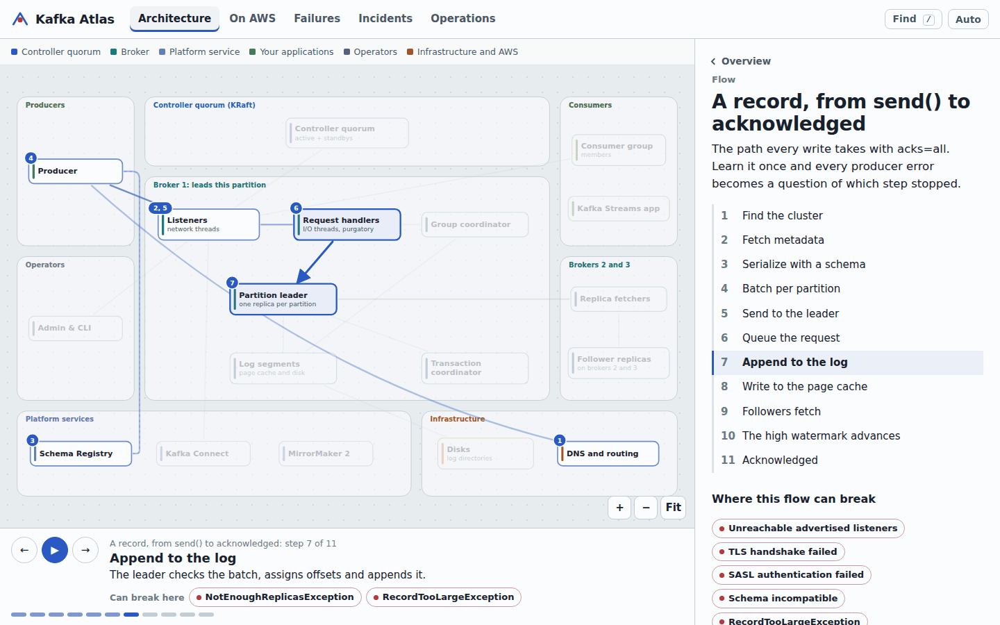
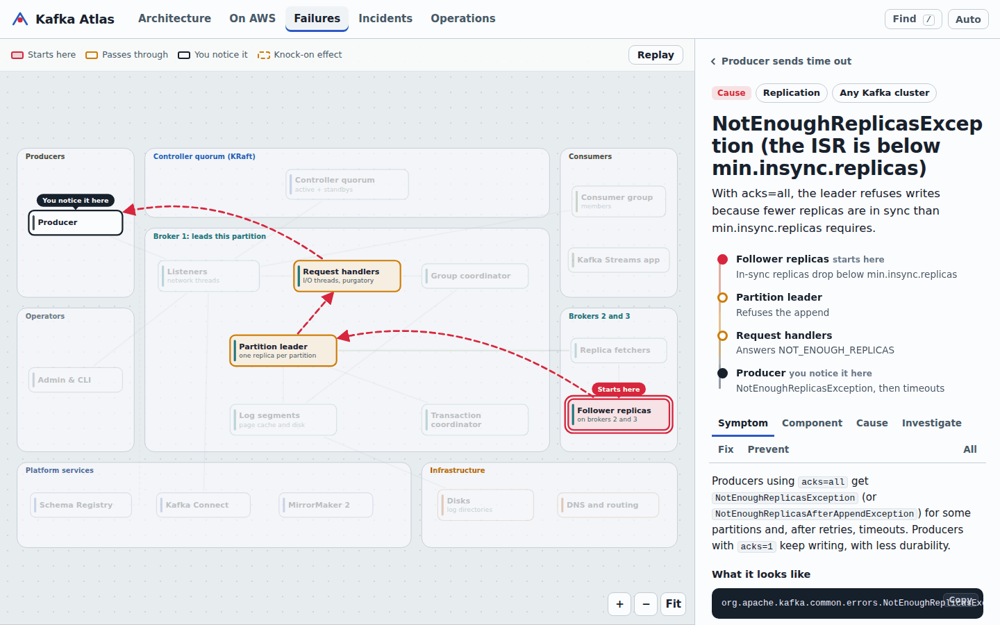
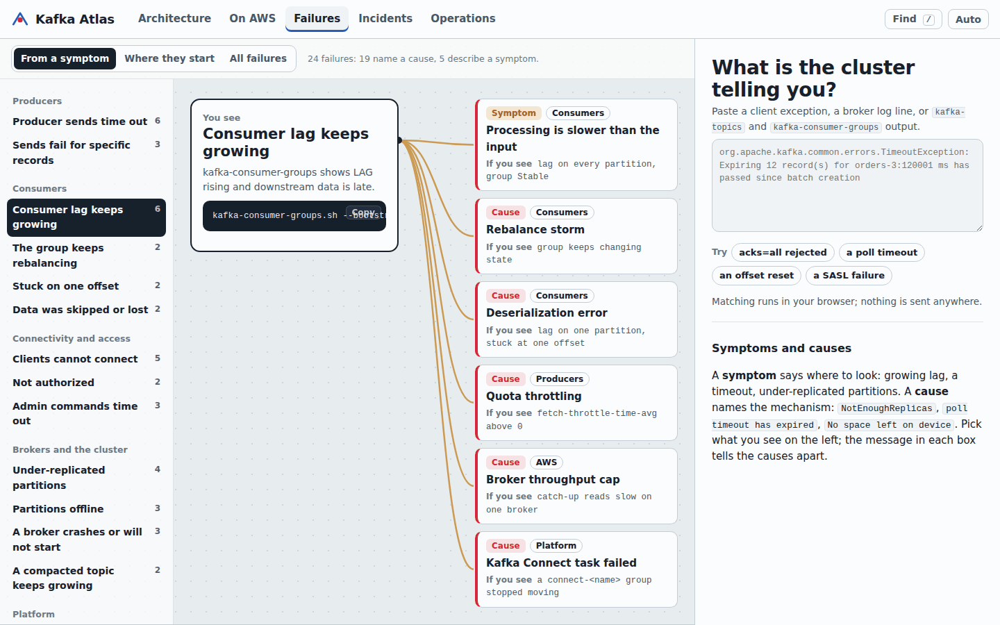
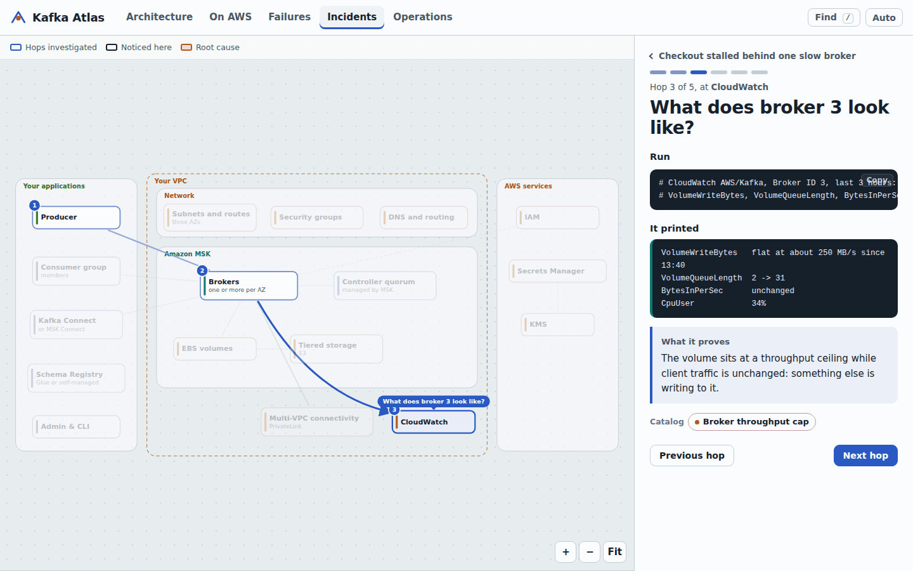
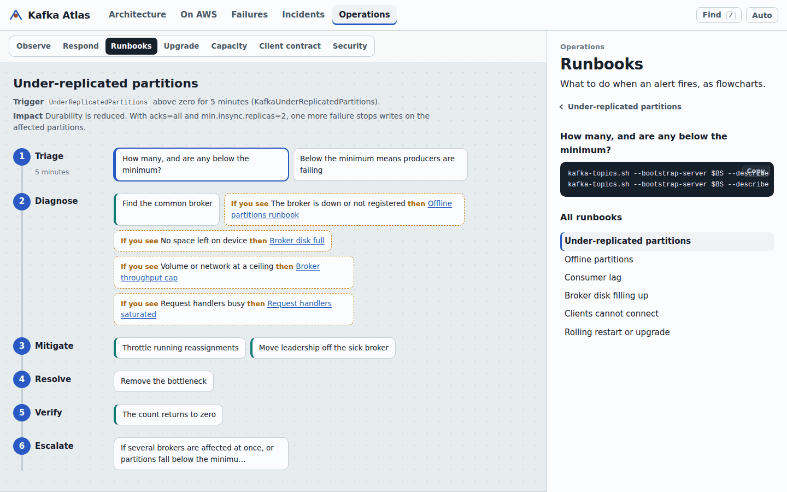
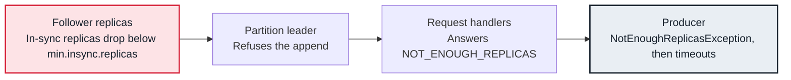
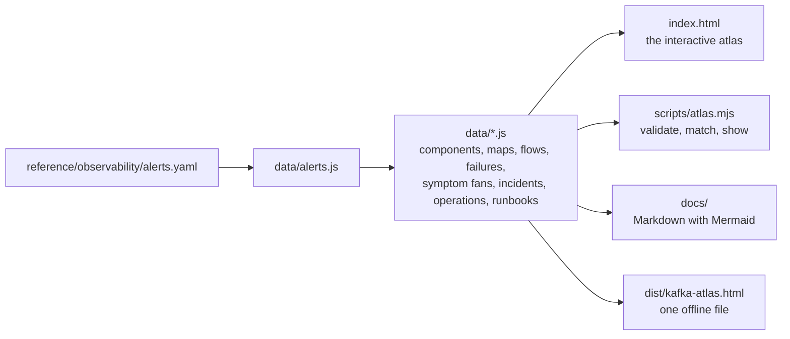

# Kafka Atlas

**Apache Kafka and Amazon MSK, drawn as a map you can click.** See what every part of a cluster does and how records travel through it, play animated flows, and watch each of 24 production failures travel from where it starts to where you notice it.



Open `index.html` in a browser. There is no build step, no server and no dependency, and nothing you paste leaves your machine.

## What's inside

| View | What you can do there |
|---|---|
| **Architecture** | Explore a cluster as a map: producers, listeners, request handlers, partition leaders and followers, log segments, group and transaction coordinators, the KRaft controller quorum, Schema Registry, Kafka Connect and MirrorMaker 2. Click any component to see how it works inside, what it connects to and which failures start there. Play five flows: a record from `send()` to acknowledged, a consumer group reading and committing, a broker dying, a rebalance, and exactly-once processing. |
| **On AWS** | Amazon MSK in your VPC through five lenses: networking (ports per authentication method), security (IAM, SASL/SCRAM, mutual TLS), storage (EBS, tiered storage, Express brokers), deployment (MSK Provisioned, Express, Serverless, Strimzi on EKS, self-managed) and observability (monitoring levels). Two flows, decision tables, a production layout and a cluster sizing calculator. |
| **Failures** | 24 failures, each with the six parts: symptom, affected component, root cause, investigation, resolution and prevention. Every one is animated on the map: red where it starts, amber where it passes through, a marker where you notice it, dashed knock-on effects. Start from what you see (14 symptom fans), from where failures begin (a heat map), or paste an exception or command output. |
| **Incidents** | Three production investigations replayed hop by hop: a slow broker behind producer timeouts, a rebalance storm after a deploy, and orders skipped because retention was shorter than an outage. Each ends with the causal chain, contributing factors and fixes. |
| **Operations** | Signals per layer and when to page, the investigation loop and the first fifteen minutes, six runbooks drawn as flowcharts, rolling upgrades, sizing, the production client contract (producer and consumer settings, line by line) and the security layers. |

| | |
|---|---|
|  |  |
| A failure travels across the map from its cause to its symptom. | Start from what you see; the tell in each box separates the causes. |
|  |  |
| Incidents replay hop by hop, each with its command and finding. | Runbooks are flowcharts; every step opens its commands. |

## How a failure is drawn

Every failure records the path it takes through the system, so the same data drives the animation in the atlas and the diagram on its Markdown page. NotEnoughReplicas, for example:



Growing lag, a producer timeout or under-replicated partitions are **symptoms**: they tell you where to look. Messages such as `NotEnoughReplicasException`, `consumer poll timeout has expired` or `No space left on device` name a **cause**. The catalog marks each entry as one or the other, and the matcher ranks causes above the symptoms they produce.

## Use it during an incident

- **Paste what the client or broker printed.** In Failures, paste an exception, a broker log line, or `kafka-topics` and `kafka-consumer-groups` output; the best match opens with its path drawn on the map.
- **Share a link.** Every view, selection and step has its own address, for example `index.html#/failures/rebalance-storm?tab=investigate` or `index.html#/incidents/one-slow-broker/3`.
- **Stay in the terminal.**

  ```sh
  grep -A3 Exception app.log | node scripts/atlas.mjs match
  node scripts/atlas.mjs show not-enough-replicas
  BS=b-1.orders.example:9098 tools/snapshot.sh billing   # read-only cluster snapshot
  ```

- **Work offline.** `npm run build` writes `dist/kafka-atlas.html`, one file you can keep on a laptop. Remove the three font lines in `index.html` and the atlas makes no network requests at all.
- **Read it as Markdown.** [`docs/failures/`](docs/failures/README.md), [`docs/runbooks/`](docs/runbooks/README.md) and [`docs/incidents.md`](docs/incidents.md) are generated from the same data, with Mermaid diagrams that GitHub renders.

## How it is built



The data files are the single source of truth. The browser loads them as plain scripts, which is why the atlas works from `file://` and on GitHub Pages without a build. `scripts/atlas.mjs` loads exactly the files `index.html` lists, in the same order, so the site, the docs and the command line cannot disagree. Validation checks every cross-reference, checks that every sample message matches its own entry first, and checks the map geometry: no station may overlap another and no connection may run through a station.

## Repository structure

```text
index.html                 the atlas: open it in a browser
assets/                    styles, the SVG map renderer, the flow player and the views
data/                      the source of truth: components, maps, flows, failures, triage, incidents, operations
docs/                      generated Markdown: failure pages, runbooks, incidents
labs/                      a three-node KRaft cluster in Docker, and failures to reproduce on it
reference/                 client settings, a KRaft broker, MSK configuration and IAM policy, Strimzi, alert rules
tools/snapshot.sh          a read-only cluster snapshot for incident channels
scripts/atlas.mjs          validate, generate docs, build one file, match, show
tests/                     unit tests and a browser smoke test
```

The examples follow Larder, a fictional grocery delivery company running `larder-prod` on Amazon MSK across three Availability Zones in `eu-west-1`. The settings in an incident are the ones in the reference configuration, and the alert that pages you leads to the entry that explains it.

## Practise on your laptop

With Docker:

```sh
make lab-up
k() { docker compose -f labs/compose.yaml exec -T kafka-1 /opt/kafka/bin/"$@"; }
BS=kafka-1:19092
k kafka-topics.sh --bootstrap-server $BS --create --topic lab-urp --partitions 6 --replication-factor 3
docker compose -f labs/compose.yaml stop kafka-3
k kafka-topics.sh --bootstrap-server $BS --describe --under-replicated-partitions
make lab-down
```

Five failures can be reproduced this way; see [`labs/`](labs/README.md).

## Development

Node 20 or later; nothing to install.

```sh
npm test                 # data integrity, matcher, layout, generated files, Markdown safety
npm run check            # validation, plus generated files are current (CI runs this)
npm run docs             # regenerate docs/ after editing data
npm run build            # dist/kafka-atlas.html
npm run serve            # http://localhost:8000, if you prefer a server to file://
npm install --no-save playwright && npx playwright install chromium
npm run test:browser     # render every view and all 24 failures in Chromium
```

Pushes to `main` publish the atlas to GitHub Pages through `.github/workflows/pages.yml` (set the Pages source to GitHub Actions).

## Contributing

Add a failure, a component, a flow or an incident by editing the data; [CONTRIBUTING.md](CONTRIBUTING.md) shows the shape of each and what validation expects. The most valuable contribution is a failure your own clusters taught you about.

## Credits

Larder is fictional; account IDs, ARNs, hostnames and figures are examples. The interface uses Overpass, a typeface drawn from highway signage by Delve Withrington, under the SIL Open Font License, loaded from Google Fonts with system fonts as the fallback. Apache Kafka and Kafka are trademarks of the Apache Software Foundation. AWS, Amazon MSK and related names are trademarks of Amazon.com, Inc. or its affiliates. This project is not affiliated with either.
