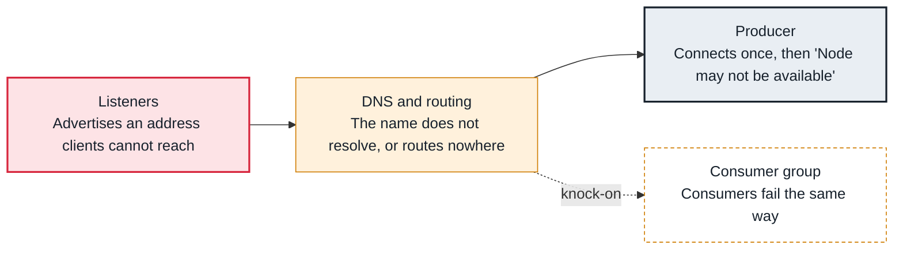

<!-- Generated from data/failures/connectivity.js by `node scripts/atlas.mjs docs`. Edit the data, then regenerate. -->

# Unreachable advertised listeners (bootstrap works, then nothing does)

Clients reach the bootstrap broker, but the broker addresses returned in metadata (advertised.listeners) do not resolve or route from the client, so every real request fails.

| Kind | Layer | Scope | Interactive |
|---|---|---|---|
| Cause | Connectivity | Any Kafka cluster | [Open in the atlas](../../index.html#/failures/advertised-listeners) |

## How it propagates



## Symptom

The first connection succeeds, then the client logs `Connection to node 1 (localhost/127.0.0.1:9092) could not be established. Node may not be available.`, or times out with 'Topic not present in metadata'. It works from inside the brokers' network and fails from outside (another VPC, a laptop, a container).

## Affected component

The broker **listener** configuration, and resolution and routing (**DNS and routing**) from the client's network; the **producer** and **consumer** both report it.

## Root cause

The bootstrap address is used only for the first metadata request. After that, clients connect to exactly the host and port each broker advertises. Advertising `localhost`, a container hostname, a private address behind NAT, or an internal name that does not resolve from the client breaks every connection after bootstrap. A separate listener per network solves it.

## Investigation

1. **What does each broker advertise?**

   ```sh
   kafka-broker-api-versions.sh --bootstrap-server $BS | grep '(id:'
   ```

   Look for: The host:port before '(id: N' is what clients will use.

2. **Resolve and connect from the client's network**

   ```sh
   getent hosts kafka-1.internal
   nc -vz kafka-1.internal 9092
   ```

   Look for: No address, or a timeout, from where the client runs.

## Resolution

Give each network its own listener and advertise an address that is valid there: `listeners=INTERNAL://:9092,EXTERNAL://:9094`, `advertised.listeners=INTERNAL://kafka-1.internal:9092,EXTERNAL://kafka-1.example.com:9094`, with `listener.security.protocol.map` to match. Restart brokers one at a time; outside clients use the external bootstrap address.

## Prevention

- Test a client from every network that must connect (other VPCs, offices, CI).
- Never advertise localhost or container-internal names in shared environments.
- Document the bootstrap address per network.

## Related

- [MSK brokers unreachable](broker-unreachable.md)
- [Producer timeouts](producer-timeout.md)

## Runbooks

- [Clients cannot connect](../runbooks/client-connectivity.md)
