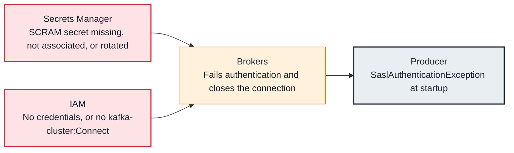

<!-- Generated from data/failures/security.js by `node scripts/atlas.mjs docs`. Edit the data, then regenerate. -->

# SASL authentication failed (SCRAM or IAM)

The brokers reject the client's identity: wrong SCRAM credentials, a secret not associated with the cluster, or IAM credentials that are missing or lack kafka-cluster:Connect.

| Kind | Layer | Scope | Interactive |
|---|---|---|---|
| Cause | Security | On AWS | [Open in the atlas](../../index.html#/failures/authentication-failed) |

## How it propagates



## Symptom

Clients fail at startup with `SaslAuthenticationException: Authentication failed during authentication due to invalid credentials with SASL mechanism SCRAM-SHA-512`, or with an access denied message when using IAM. Retries do not help.

## Affected component

The **brokers** perform the check; the credentials come from **Secrets Manager** (SCRAM) or **IAM** (IAM access control).

## Root cause

With SCRAM, MSK only knows secrets that are associated with the cluster, named with the `AmazonMSK_` prefix and encrypted with a customer managed KMS key. With IAM, the client must use the IAM mechanism on port 9098, and its role must allow `kafka-cluster:Connect` on the cluster. A rotated password, a different AWS identity inside the container, or a missing policy all fail here.

## Investigation

1. **Which identity and mechanism?**

   ```sh
   grep -E 'sasl.mechanism|security.protocol' client.properties
   aws sts get-caller-identity
   ```

   Look for: SCRAM-SHA-512 on 9096 or AWS_MSK_IAM on 9098, and the role you expect.

2. **SCRAM: is the secret associated?**

   ```sh
   aws kafka list-scram-secrets --cluster-arn $CLUSTER_ARN
   ```

   Look for: The secret's ARN in the list.

3. **IAM: may the role connect?**

   ```sh
   aws iam simulate-principal-policy --policy-source-arn $ROLE_ARN --action-names kafka-cluster:Connect --resource-arns $CLUSTER_ARN --query 'EvaluationResults[].EvalDecision'
   ```

   Look for: allowed

## Resolution

For SCRAM, associate the secret (`aws kafka batch-associate-scram-secret`), check its name and KMS key, and update clients after a rotation. For IAM, attach a policy that allows `kafka-cluster:Connect` plus the topic and group actions the client needs, and use the aws-msk-iam-auth library with `sasl.mechanism=AWS_MSK_IAM` or OAUTHBEARER.

## Prevention

- One credential per service, rotated with an overlap period.
- Test authentication during deployment, before traffic shifts.
- Alert on broker authentication failure counts.

## Related

- [Not authorized](authorization-failed.md)
- [TLS handshake failed](tls-handshake-failed.md)

## Runbooks

- [Clients cannot connect](../runbooks/client-connectivity.md)
