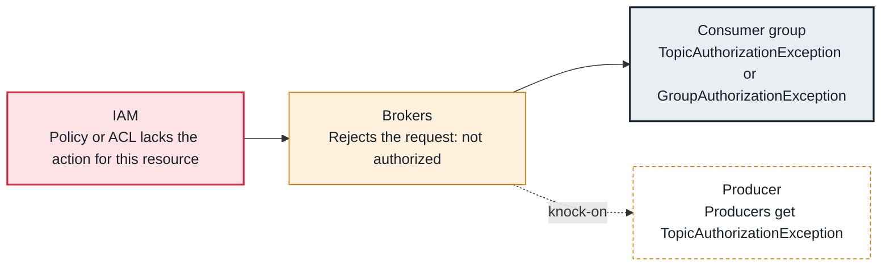

<!-- Generated from data/failures/security.js by `node scripts/atlas.mjs docs`. Edit the data, then regenerate. -->

# Not authorized (topic, group or transactional ID)

The client is authenticated, but its ACLs or IAM policies do not allow this operation on this topic, group or transactional ID.

| Kind | Layer | Scope | Interactive |
|---|---|---|---|
| Cause | Security | Any Kafka cluster | [Open in the atlas](../../index.html#/failures/authorization-failed) |

## How it propagates



## Symptom

Requests fail with `TopicAuthorizationException: Not authorized to access topics: [orders]`, `GroupAuthorizationException: Not authorized to access group: billing`, or `TransactionalIdAuthorizationException`. The connection itself succeeds.

## Affected component

The **brokers**' authorizer: Kafka ACLs, or **IAM** policies when MSK IAM access control is on.

## Root cause

Each operation needs its own permission. Producing needs Write on the topic (IAM `kafka-cluster:WriteData` and `DescribeTopic`); consuming needs Read on the topic and on the group (`ReadData`, `AlterGroup`, `DescribeGroup`); idempotent and transactional producers need extra rights. A new topic, a renamed group or a newly transactional producer is not covered by an old policy.

## Investigation

1. **Read the exact resource**

   ```sh
   grep -E 'AuthorizationException' app.log | tail -3
   ```

   Look for: The topic, group or transactional ID named in the message.

2. **Kafka ACLs: what is granted?**

   ```sh
   kafka-acls.sh --bootstrap-server $BS --command-config admin.properties --list --principal User:billing
   ```

   Look for: A missing operation, or a LITERAL pattern where PREFIXED was intended.

3. **IAM: simulate the actions**

   ```sh
   aws iam simulate-principal-policy --policy-source-arn $ROLE_ARN --action-names kafka-cluster:ReadData kafka-cluster:AlterGroup --resource-arns $TOPIC_ARN $GROUP_ARN --query 'EvaluationResults[].[EvalActionName,EvalDecision]'
   ```

   Look for: implicitDeny for the failing action.

## Resolution

Grant the missing operation on the right resource. With ACLs: `kafka-acls.sh --add --allow-principal User:billing --operation Read --topic orders --group billing`. With IAM: add the `kafka-cluster` actions with the topic and group ARNs; a wildcard per team prefix keeps policies maintainable.

## Prevention

- Define access per service as code, next to the topic definitions.
- Use prefixed patterns per team (orders.*) so new topics are covered deliberately.
- Test new clients in staging with production-like permissions.

## Related

- [SASL authentication failed](authentication-failed.md)

## Runbooks

- [Clients cannot connect](../runbooks/client-connectivity.md)
