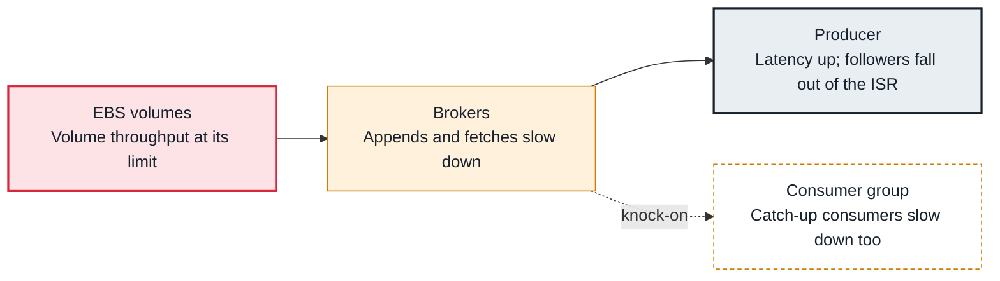

<!-- Generated from data/failures/aws.js by `node scripts/atlas.mjs docs`. Edit the data, then regenerate. -->

# Broker throughput cap (EBS or network limit reached)

A broker reaches an infrastructure throughput limit (its volume's throughput or its instance's network allowance), and every partition it hosts slows down, without any error.

| Kind | Layer | Scope | Interactive |
|---|---|---|---|
| Cause | AWS | On AWS | [Open in the atlas](../../index.html#/failures/broker-throughput-cap) |

## How it propagates



## Symptom

Produce and fetch latency rise together on one or more brokers, followers leave the ISR (under-replicated partitions), and consumers reading older data slow down. CPU is moderate and nothing logs an error.

## Affected component

The **EBS volume** or the network allowance of a **broker**; **producers** and **consumers** of every partition on it feel it; **CloudWatch** shows it.

## Root cause

Each broker writes its share of ingress plus all replication from other leaders, and serves consumer and follower fetches. Reads that miss the page cache, partition reassignments and tiered storage uploads use the same volume and network. When the total passes the volume's throughput or the instance's sustained bandwidth, I/O queues and latency grows for everything on that broker.

## Investigation

1. **Read the broker throughput metrics**

   ```sh
   # CloudWatch AWS/Kafka per broker (PER_BROKER level or higher):
   # BytesInPerSec, BytesOutPerSec, ReplicationBytesInPerSec, VolumeWriteBytes, VolumeQueueLength,
   # BwInAllowanceExceeded, BwOutAllowanceExceeded
   ```

   Look for: Volume throughput flat at a ceiling, a growing volume queue, or allowance counters above zero.

2. **Is the load uneven?**

   ```sh
   kafka-topics.sh --bootstrap-server $BS --describe | grep -oE 'Leader: [0-9]+' | sort | uniq -c
   ```

   Look for: One broker leading more partitions than the others.

## Resolution

First remove extra load: throttle reassignments and backfills, and spread leadership. Then add capacity: provision storage throughput (or use larger brokers), add brokers and move partitions onto them, or move to Express brokers, which have no broker volumes to size. Tiered storage reduces local disk reads of old data.

## Prevention

- Size brokers for ingress times replication factor plus consumer fan-out, with 40% headroom.
- Alert on network allowance counters and on volume queue length.
- Keep partitions and leadership balanced across brokers and zones.

## Related

- [Under-replicated partitions](under-replicated-partitions.md)
- [Request handlers saturated](request-handler-saturation.md)
- [Broker disk full](disk-full.md)

## Runbooks

- [Under-replicated partitions](../runbooks/under-replicated.md)
