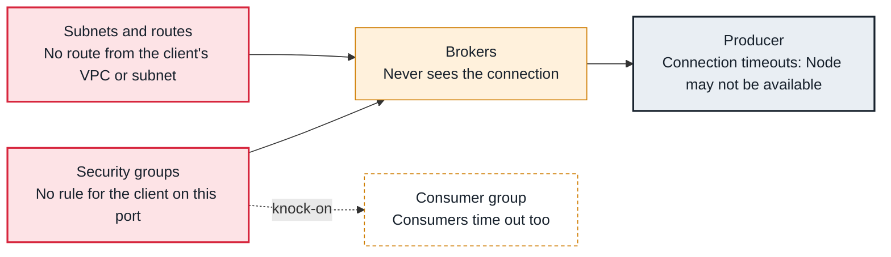

<!-- Generated from data/failures/connectivity.js by `node scripts/atlas.mjs docs`. Edit the data, then regenerate. -->

# MSK brokers unreachable (security group, route or port)

Clients cannot open connections to the MSK brokers at all: a security group, a route or a port mismatch drops the traffic.

| Kind | Layer | Scope | Interactive |
|---|---|---|---|
| Cause | Connectivity | On AWS | [Open in the atlas](../../index.html#/failures/broker-unreachable) |

## How it propagates



## Symptom

Clients log `Connection to node -1 (b-1.<cluster>...amazonaws.com/10.x.x.x:9098) could not be established` and admin tools hang until they time out. Nothing reaches the brokers, so broker metrics look healthy.

## Affected component

The network path to the **brokers**: **security groups**, **subnets and routes**, and the port of the authentication method in use. The **producer** reports it.

## Root cause

MSK listens on a different port for each authentication method: 9092 plaintext, 9094 TLS, 9096 SASL/SCRAM, 9098 IAM. A client on the IAM port whose security group rule allows only 9092, a client in a VPC with no peering or private connectivity, or a network ACL blocking return traffic all fail as silent drops.

## Investigation

1. **Which bootstrap string and port?**

   ```sh
   aws kafka get-bootstrap-brokers --cluster-arn $CLUSTER_ARN
   ```

   Look for: BootstrapBrokerStringSaslIam uses 9098; compare with the client configuration.

2. **Test from where the client runs**

   ```sh
   nc -vz b-1.orders.abc123.c2.kafka.eu-west-1.amazonaws.com 9098
   ```

   Look for: Timeout: the network path. Refused: the wrong port. Open: look at TLS and authentication next.

3. **Read the brokers' security group**

   ```sh
   aws ec2 describe-security-groups --group-ids $BROKER_SG --query 'SecurityGroups[].IpPermissions[].[FromPort,ToPort,UserIdGroupPairs[].GroupId]'
   ```

   Look for: An inbound rule for the client's group on the port in use.

## Resolution

Allow the client's security group on the brokers' group for the exact ports in use (9092 to 9098 if several methods are on). Connect other VPCs with peering, Transit Gateway or MSK multi-VPC connectivity, and check that broker names resolve there.

## Prevention

- Manage broker security group rules in the same code as the client services.
- Check connectivity to every broker in each client's deployment pipeline.
- Prefer one authentication method per cluster, so there is one port to open.

## Related

- [Unreachable advertised listeners](advertised-listeners.md)
- [SASL authentication failed](authentication-failed.md)
- [TLS handshake failed](tls-handshake-failed.md)

## Runbooks

- [Clients cannot connect](../runbooks/client-connectivity.md)
