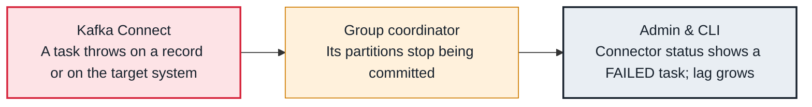

<!-- Generated from data/failures/platform.js by `node scripts/atlas.mjs docs`. Edit the data, then regenerate. -->

# Kafka Connect task failed

A connector task hits an error it does not tolerate and stops. It stays FAILED until someone restarts it, while the worker and the other tasks look healthy.

| Kind | Layer | Scope | Interactive |
|---|---|---|---|
| Cause | Platform | Any Kafka cluster | [Open in the atlas](../../index.html#/failures/connect-task-failed) |

## How it propagates



## Symptom

`GET /connectors/<name>/status` shows the connector RUNNING but a task FAILED, with a trace ending 'Task is being killed and will not recover until manually restarted'. Data stops for that task's partitions and the sink's consumer group lag grows.

## Affected component

**Kafka Connect** workers and their tasks; for sink connectors the stalled offsets show up at the **group coordinator** as lag.

## Root cause

By default (`errors.tolerance=none`) any conversion or transformation error kills the task. Errors at the target (an unreachable database, a table that no longer matches) also fail tasks after their retries. Connect restarts failed tasks only when asked, so a short outage at night becomes hours of stopped data.

## Investigation

1. **Find the failed task and its error**

   ```sh
   curl -s $CONNECT/connectors/orders-sink/status | jq '.tasks[] | {id, state}'
   curl -s $CONNECT/connectors/orders-sink/status | jq -r '.tasks[0].trace' | head -5
   ```

   Look for: The first 'Caused by' line names the bad record or the target error.

2. **Look at the sink's lag**

   ```sh
   kafka-consumer-groups.sh --bootstrap-server $BS --describe --group connect-orders-sink
   ```

   Look for: Partitions owned by the failed task stop advancing.

## Resolution

Fix the cause, then restart only what failed: `curl -X POST "$CONNECT/connectors/orders-sink/restart?includeTasks=true&onlyFailed=true"`. For bad records, set `errors.tolerance=all` with `errors.deadletterqueue.topic.name` on sinks and `errors.log.enable=true`, so one record no longer stops the pipeline.

## Prevention

- Alert on failed tasks (connector-failed-task-count), not only on worker health.
- Configure a dead letter queue for every sink connector.
- Restart failed tasks automatically only for errors known to be transient.

Alerts that lead here: `KafkaConnectTaskFailed` (ticket).

## Related

- [Deserialization error](deserialization-error.md)
- [Schema incompatible](schema-incompatible.md)
