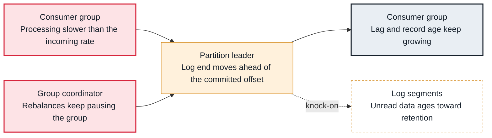

<!-- Generated from data/failures/consumer.js by `node scripts/atlas.mjs docs`. Edit the data, then regenerate. -->

# Consumer lag keeps growing

Consumers fall behind the end of the log: they process more slowly than producers write, or they keep stopping.

| Kind | Layer | Scope | Interactive |
|---|---|---|---|
| Symptom | Consumers | Any Kafka cluster | [Open in the atlas](../../index.html#/failures/consumer-lag) |

## How it propagates



## Symptom

`kafka-consumer-groups --describe` shows LAG growing on some or all partitions, and downstream data arrives late. How old the next unread record is matters more than how many records are waiting.

## Affected component

Measured at the **partition leader** (the log end offset) against the **consumer group**'s committed offsets. The cause is almost always in the consumer: processing speed, parallelism or rebalances, which the **group coordinator** runs.

## Root cause

Lag grows when records arrive faster than the group processes them. Usual reasons: per-record work became slower (a slow downstream call), parallelism is capped by the partition count, one hot partition receives most keys, or rebalances keep stopping consumption. Lag on one partition points at a hot key or a stuck record; lag everywhere points at capacity.

## Investigation

1. **Where is the lag?**

   ```sh
   kafka-consumer-groups.sh --bootstrap-server $BS --describe --group billing
   ```

   Look for: LAG per partition and CONSUMER-ID: one partition or all? Any partition without an owner?

2. **Is the group stable?**

   ```sh
   kafka-consumer-groups.sh --bootstrap-server $BS --describe --group billing --state
   ```

   Look for: Stable is healthy; PreparingRebalance or CompletingRebalance that persists means a rebalance storm.

3. **How fast does each member process?**

   ```sh
   # consumer metrics: records-consumed-rate, records-lag-max, and your own time per record
   ```

   Look for: Compare the consumed rate with the topic's produce rate.

## Resolution

Make processing keep up: batch downstream calls, process in parallel inside a member while keeping per-key order, or add members up to the partition count. When members already equal partitions, add partitions (new records then map to partitions differently). Fix a hot partition with a better key. If rebalances are the cause, see the rebalance storm entry.

## Prevention

- Alert on time lag (age of the oldest unread record), not only on offset lag.
- Size partitions for the parallelism you need at peak, with headroom.
- Chart consumed rate against produce rate for every critical group.

## Related

- [Rebalance storm](rebalance-storm.md)
- [Quota throttling](quota-throttling.md)
- [Offset out of range](offset-out-of-range.md)

## Runbooks

- [Consumer lag](../runbooks/consumer-lag.md)
