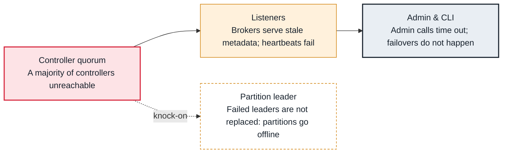

<!-- Generated from data/failures/controller.js by `node scripts/atlas.mjs docs`. Edit the data, then regenerate. -->

# Controller quorum unavailable (no active KRaft controller)

The KRaft controller quorum has no leader, because a majority of controllers is down or cut off, so no metadata can change: no leader elections, no topic changes, no broker registrations.

| Kind | Layer | Scope | Interactive |
|---|---|---|---|
| Cause | Controller | Any Kafka cluster | [Open in the atlas](../../index.html#/failures/controller-quorum-unavailable) |

## How it propagates



## Symptom

Admin commands (create a topic, change a config) time out; `kafka-metadata-quorum describe --status` shows no leader or a high watermark that does not move. Existing partitions keep working, but when a broker fails its partitions are not moved, and restarted brokers cannot register.

## Affected component

The **controller quorum**. Brokers' **listeners** keep serving cached metadata, **admin** clients fail, and a **leader** that dies is not replaced.

## Root cause

KRaft needs a majority of voters (two of three, three of five) to elect a leader and commit metadata. Losing two of three controllers (or combined broker-controllers), placing voters in only two zones, a network partition between them, or a full controller disk stops the quorum. Brokers whose heartbeats go unanswered are eventually fenced.

## Investigation

1. **Is there a leader?**

   ```sh
   kafka-metadata-quorum.sh --bootstrap-server $BS describe --status
   ```

   Look for: LeaderId (-1 means none), and a HighWatermark that advances between runs.

2. **Which voters are behind or down?**

   ```sh
   kafka-metadata-quorum.sh --bootstrap-server $BS describe --replication
   ```

   Look for: Voters with large Lag or a LastFetchTimestamp far in the past.

3. **Read the controller logs**

   ```sh
   grep -iE 'error|fenc|election' /var/log/kafka/controller.log | tail
   ```

   Look for: Repeated elections, fencing, or disk errors.

## Resolution

Restore a majority of voters: restart failed controllers, fix their disks or network. Never wipe a controller's metadata directory to make it start; follow the documented procedure for replacing a voter. Once the quorum has a leader, brokers re-register and leadership converges.

## Prevention

- Run three (or five) dedicated controllers, one per zone.
- Alert when the cluster's ActiveControllerCount sum is not 1, and when the metadata high watermark stops.
- Give controllers their own disks and monitor them.

Alerts that lead here: `KafkaNoActiveController` (page).

## Related

- [Offline partitions](offline-partitions.md)

## Runbooks

- [Offline partitions](../runbooks/offline-partitions.md)
