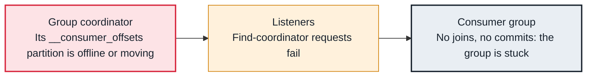

<!-- Generated from data/failures/consumer.js by `node scripts/atlas.mjs docs`. Edit the data, then regenerate. -->

# Group coordinator not available

The group cannot find or reach its coordinator, so it cannot join, rebalance or commit: usually because the group's __consumer_offsets partition has no leader, or its broker is overloaded or restarting.

| Kind | Layer | Scope | Interactive |
|---|---|---|---|
| Symptom | Consumers | Any Kafka cluster | [Open in the atlas](../../index.html#/failures/coordinator-not-available) |

## How it propagates



## Symptom

Consumers log `The coordinator is not available` or that the coordinator 'is unavailable or invalid', and retry. Briefly that is normal during a broker restart; if it lasts, the group consumes nothing and commits fail.

## Affected component

The **group coordinator** role sits on the broker that leads the group's `__consumer_offsets` partition; the **consumer** only reports it.

## Root cause

Each group maps to one of the 50 `__consumer_offsets` partitions. If that partition is offline (its replicas are down, or the topic was created with replication factor 1), or its leader just failed over and is still loading offsets, the coordinator cannot serve the group. Clusters that began with one broker often keep `__consumer_offsets` at replication factor 1.

## Investigation

1. **Is __consumer_offsets healthy?**

   ```sh
   kafka-topics.sh --bootstrap-server $BS --describe --topic __consumer_offsets | head -2
   kafka-topics.sh --bootstrap-server $BS --describe --topic __consumer_offsets --unavailable-partitions
   ```

   Look for: Replication factor below 3, or partitions without a leader.

2. **Which broker coordinates the group?**

   ```sh
   kafka-consumer-groups.sh --bootstrap-server $BS --describe --group billing --state
   ```

   Look for: The COORDINATOR column; check that broker's health and logs.

## Resolution

Restore the leader of the affected `__consumer_offsets` partition by bringing its broker back. If the topic has replication factor 1, reassign it to three replicas on different brokers. Persistent errors on a healthy cluster point at an overloaded coordinator broker: see request handler saturation.

## Prevention

- Set offsets.topic.replication.factor=3 before the first consumer connects.
- Alert on offline partitions of internal topics.
- Keep internal topics at min.insync.replicas=2.

## Related

- [Offline partitions](offline-partitions.md)
- [Rebalance storm](rebalance-storm.md)

## Runbooks

- [Offline partitions](../runbooks/offline-partitions.md)
