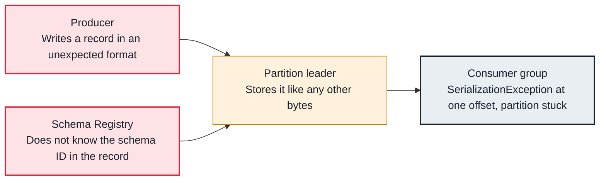

<!-- Generated from data/failures/consumer.js by `node scripts/atlas.mjs docs`. Edit the data, then regenerate. -->

# Deserialization error (a poison pill stops a partition)

One record cannot be deserialized (another format, an unknown schema ID, corrupt bytes), and a consumer that does not handle it stops at that offset.

| Kind | Layer | Scope | Interactive |
|---|---|---|---|
| Cause | Consumers | Any Kafka cluster | [Open in the atlas](../../index.html#/failures/deserialization-error) |

## How it propagates



## Symptom

The consumer throws `RecordDeserializationException` or `SerializationException` for the same partition and offset on every poll. Lag grows on that one partition while the others are fine. A Kafka Streams application stops with the default handler.

## Affected component

Seen by the **consumer**. The record came from a **producer** using another serializer, a test message typed by hand, or a schema the **Schema Registry** does not know.

## Root cause

Kafka stores bytes; only clients interpret them. JSON written to a topic read with Avro, a console message, or a record whose schema ID belongs to another registry all fail in the deserializer. The consumer's position does not move past an exception, so it retries the same record forever.

## Investigation

1. **Find the offset**

   ```sh
   grep -E 'Error deserializing|RecordDeserializationException|Unknown magic byte' app.log | tail -3
   ```

   Look for: Partition and offset in the message.

2. **Look at the raw record**

   ```sh
   kafka-console-consumer.sh --bootstrap-server $BS --topic orders --partition 2 --offset 1500 --max-messages 1 --property print.headers=true | xxd | head
   ```

   Look for: Records written with a schema registry start with a zero magic byte and a four-byte schema ID.

## Resolution

Skip or quarantine the record: route deserialization failures to a dead letter topic (Spring Kafka's DeadLetterPublishingRecoverer, Kafka Streams' LogAndContinueExceptionHandler), or save it and seek past the offset once. Then fix the producer that wrote it.

## Prevention

- Use a schema registry with serializers that validate when producing.
- Give every consumer a dead letter path, so one record cannot stop a partition.
- Restrict who may write to production topics.

## Related

- [Schema incompatible](schema-incompatible.md)
- [Kafka Connect task failed](connect-task-failed.md)

## Runbooks

- [Consumer lag](../runbooks/consumer-lag.md)
