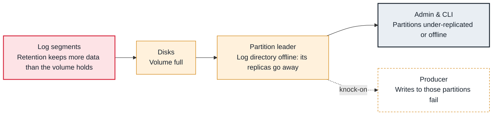

<!-- Generated from data/failures/broker.js by `node scripts/atlas.mjs docs`. Edit the data, then regenerate. -->

# Broker disk full (log directory offline)

A broker's log directory runs out of space; the broker takes every partition in that directory offline, and stops if it was the only directory.

| Kind | Layer | Scope | Interactive |
|---|---|---|---|
| Cause | Brokers | Any Kafka cluster | [Open in the atlas](../../index.html#/failures/disk-full) |

## How it propagates



## Symptom

Broker logs show `java.io.IOException: No space left on device` followed by 'Stopping serving logs in dir'. Partitions on that broker become under-replicated or offline; with a single log directory the broker shuts down.

## Affected component

The **disk** under the **log** directory. The broker marks the directory offline, so the **leader** and follower replicas stored there disappear.

## Root cause

Disk use is every partition's retained segments, plus segments not yet deleted (retention deletes whole closed segments at each check), plus room for compaction. It jumps when retention is raised, a new high-volume topic appears, partitions are moved onto the broker, or tiered storage stops uploading.

## Investigation

1. **Confirm, and find the directory**

   ```sh
   df -h /var/lib/kafka/data
   grep -E 'No space left|Stopping serving (logs|replicas) in dir' /var/log/kafka/server.log | tail
   ```

   Look for: Which directory failed, and when.

2. **Which topics use the space?**

   ```sh
   kafka-log-dirs.sh --bootstrap-server $BS --describe --broker-list 3 | tail -1 | jq -r '.brokers[].logDirs[].partitions[] | [.size, .partition] | @tsv' | sort -rn | head
   ```

   Look for: A few partitions usually dominate.

## Resolution

Free space before restarting: lower `retention.ms` or `retention.bytes` on the largest topics (deletion follows within minutes), delete unused topics, or grow the volume (MSK storage auto scaling or an EBS resize). Then restart the broker so the directory comes back. Never delete segment files by hand.

## Prevention

- Alert at 75% and page at 85% disk use per broker.
- Set retention.bytes on high-volume topics as a ceiling.
- Use tiered storage to keep long retention off local disks.

## Related

- [Under-replicated partitions](under-replicated-partitions.md)
- [Offline partitions](offline-partitions.md)
- [Broker throughput cap](broker-throughput-cap.md)

## Runbooks

- [Under-replicated partitions](../runbooks/under-replicated.md)
- [Offline partitions](../runbooks/offline-partitions.md)
- [Broker disk filling up](../runbooks/disk-usage.md)
