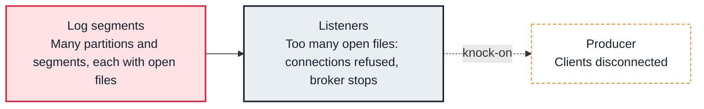

<!-- Generated from data/failures/broker.js by `node scripts/atlas.mjs docs`. Edit the data, then regenerate. -->

# Too many open files (file descriptors or memory maps exhausted)

The broker runs out of file descriptors or memory maps, because every partition segment and every client connection holds one.

| Kind | Layer | Scope | Interactive |
|---|---|---|---|
| Cause | Brokers | Any Kafka cluster | [Open in the atlas](../../index.html#/failures/file-descriptor-exhaustion) |

## How it propagates



## Symptom

Broker logs show `java.io.IOException: Too many open files` (often from the acceptor) or `java.io.IOException: Map failed`, followed by a crash or refused connections. It often appears after adding partitions or during a reassignment.

## Affected component

The broker process. The pressure comes from the **log** (each segment keeps a log file and memory-mapped index files open) and from client connections on the **listeners**.

## Root cause

Descriptors needed are roughly partitions on the broker times segments per partition times two or three, plus connections. Memory maps are capped by `vm.max_map_count` (65530 by default on Linux). A small `segment.ms` or `segment.bytes` multiplies segments; thousands of partitions per broker reach the limits quickly.

## Investigation

1. **Compare use with the limits**

   ```sh
   pid=$(pgrep -f kafka.Kafka)
   ls /proc/$pid/fd | wc -l; grep 'Max open files' /proc/$pid/limits
   wc -l < /proc/$pid/maps; sysctl vm.max_map_count
   ```

   Look for: Open files or maps close to their limit.

2. **Count partitions and segments**

   ```sh
   kafka-log-dirs.sh --bootstrap-server $BS --describe --broker-list 1 | tail -1 | jq '[.brokers[].logDirs[].partitions[]] | length'
   find /var/lib/kafka/data -name '*.log' | wc -l
   ```

   Look for: Thousands of partitions, or very many segments per partition.

## Resolution

Raise the limits (systemd `LimitNOFILE=100000` or more, `vm.max_map_count=262144`) and restart the broker. Then reduce the demand: avoid tiny `segment.ms` settings, delete unused topics, and spread partitions over more brokers.

## Prevention

- Set nofile and vm.max_map_count in the broker image, not by hand.
- Budget partitions per broker and check it in topic reviews.
- Alert when open file descriptors pass 70% of the limit.

Alerts that lead here: `KafkaOpenFileDescriptorsHigh` (ticket).

## Related

- [Broker disk full](disk-full.md)
- [Request handlers saturated](request-handler-saturation.md)
