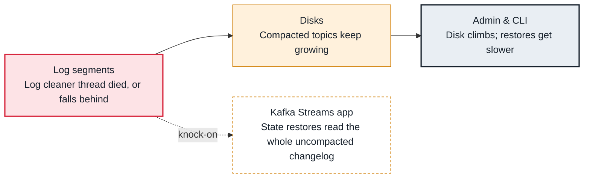

<!-- Generated from data/failures/broker.js by `node scripts/atlas.mjs docs`. Edit the data, then regenerate. -->

# Log compaction stuck (a compacted topic grows without bound)

The log cleaner stopped or cannot keep up, so a compacted topic keeps every version of every key and grows without bound.

| Kind | Layer | Scope | Interactive |
|---|---|---|---|
| Cause | Brokers | Any Kafka cluster | [Open in the atlas](../../index.html#/failures/log-compaction-stuck) |

## How it propagates



## Symptom

A topic with `cleanup.policy=compact` (a changelog, `__consumer_offsets`, a table topic) grows steadily. `time-since-last-run-ms` keeps rising, `DeadThreadCount` is above zero, or the logs show the cleaner thread dying. Kafka Streams restores take longer every time.

## Affected component

The log cleaner, part of the **log** subsystem; the growth lands on the **disk**, and readers such as **Kafka Streams** restores pay for it.

## Root cause

Compaction runs in `log.cleaner.threads` background threads. A cleaner thread that hits an unexpected error dies and stays dead until the broker restarts. A live cleaner can still fall behind when write volume outpaces it, and per-topic settings such as `min.cleanable.dirty.ratio`, `min.compaction.lag.ms` or a very long `segment.ms` delay it on purpose, because the active segment is never compacted.

## Investigation

1. **Is the cleaner alive?**

   ```sh
   grep -E 'kafka-log-cleaner-thread' /var/log/kafka/log-cleaner.log /var/log/kafka/server.log | tail
   # JMX: kafka.log:type=LogCleaner,name=DeadThreadCount and kafka.log:type=LogCleanerManager,name=time-since-last-run-ms
   ```

   Look for: An exception from a cleaner thread, or hours since the last run.

2. **Which topics are dirty?**

   ```sh
   # JMX: kafka.log:type=LogCleanerManager,name=max-dirty-percent
   kafka-log-dirs.sh --bootstrap-server $BS --describe --topic-list app-changelog | tail -1 | jq '[.brokers[].logDirs[].partitions[].size] | add'
   ```

   Look for: A compacted topic whose size keeps rising day after day.

## Resolution

Fix the error the cleaner logged, then restart the broker to restart its cleaner threads. If it is alive but behind, add `log.cleaner.threads` or a larger `log.cleaner.dedupe.buffer.size`. Check the topic's `segment.ms` and `min.cleanable.dirty.ratio`: a segment that never closes is never compacted.

## Prevention

- Alert on DeadThreadCount above zero and time-since-last-run-ms above an hour.
- Chart the size of compacted topics over time, not only disk.
- Keep segment.ms in hours, not weeks, on compacted topics.

Alerts that lead here: `KafkaLogCleanerDead` (ticket).

## Related

- [Broker disk full](disk-full.md)

## Runbooks

- [Broker disk filling up](../runbooks/disk-usage.md)
