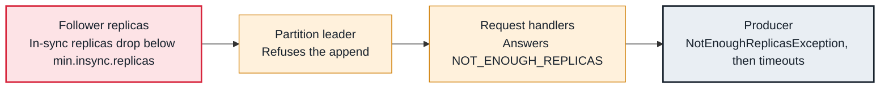

<!-- Generated from data/failures/replication.js by `node scripts/atlas.mjs docs`. Edit the data, then regenerate. -->

# NotEnoughReplicasException (the ISR is below min.insync.replicas)

With acks=all, the leader refuses writes because fewer replicas are in sync than min.insync.replicas requires.

| Kind | Layer | Scope | Interactive |
|---|---|---|---|
| Cause | Replication | Any Kafka cluster | [Open in the atlas](../../index.html#/failures/not-enough-replicas) |

## How it propagates



## Symptom

Producers using `acks=all` get `NotEnoughReplicasException` (or `NotEnoughReplicasAfterAppendException`) for some partitions and, after retries, timeouts. Producers with `acks=1` keep writing, with less durability.

## Affected component

The **partition leader** enforces `min.insync.replicas`; the **followers** that fell out of the ISR are the cause; the **producer** sees the error.

## Root cause

`min.insync.replicas` is the number of copies a write must reach before it is acknowledged. With replication factor 3 and a minimum of 2, one replica can be lost. When two are out of sync, the partition stops accepting acks=all writes. This protects durability by design. Replication factor 2 with a minimum of 2 tolerates no loss at all.

## Investigation

1. **Which partitions are below the minimum?**

   ```sh
   kafka-topics.sh --bootstrap-server $BS --describe --under-min-isr-partitions
   ```

   Look for: Partitions listed here reject acks=all writes.

2. **Check the settings**

   ```sh
   kafka-configs.sh --bootstrap-server $BS --describe --entity-type topics --entity-name orders --all | grep min.insync
   ```

   Look for: min.insync.replicas equal to the replication factor leaves no room for a failure.

## Resolution

Restore the missing replicas: bring brokers back, fix the slow follower. Do not lower `min.insync.replicas` to silence the error unless you accept the durability loss on purpose, and restore it afterwards. Use replication factor 3 with min.insync.replicas=2 for every topic that matters.

## Prevention

- Replication factor 3, min.insync.replicas=2, brokers spread across three zones.
- Alert on UnderMinIsrPartitionCount, which fires before producers fail.
- Never take two brokers down for maintenance at the same time.

Alerts that lead here: `KafkaUnderMinIsrPartitions` (page).

## Related

- [Under-replicated partitions](under-replicated-partitions.md)
- [Producer timeouts](producer-timeout.md)

## Runbooks

- [Under-replicated partitions](../runbooks/under-replicated.md)

## Reproduce it locally

```sh
k kafka-topics.sh --bootstrap-server $BS --create --topic lab-durable --partitions 1 --replication-factor 3 --config min.insync.replicas=3
docker compose -f labs/compose.yaml stop kafka-3
echo hello | k kafka-console-producer.sh --bootstrap-server $BS --topic lab-durable --producer-property acks=all
docker compose -f labs/compose.yaml start kafka-3
```

Start the lab cluster first: see [labs/](../../labs/README.md).
