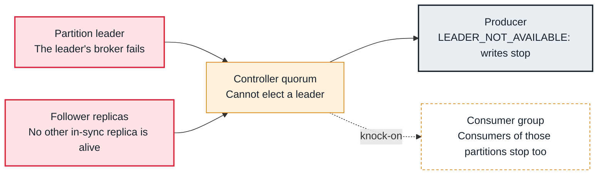

<!-- Generated from data/failures/replication.js by `node scripts/atlas.mjs docs`. Edit the data, then regenerate. -->

# Offline partitions (no leader)

Partitions have no leader because no replica that may become leader is available, so they can be neither written nor read.

| Kind | Layer | Scope | Interactive |
|---|---|---|---|
| Symptom | Replication | Any Kafka cluster | [Open in the atlas](../../index.html#/failures/offline-partitions) |

## How it propagates



## Symptom

`OfflinePartitionsCount` is above zero; `kafka-topics --describe --unavailable-partitions` lists partitions with `Leader: none`. Producers and consumers of those partitions keep getting `LEADER_NOT_AVAILABLE` or `NOT_LEADER_OR_FOLLOWER`.

## Affected component

The **controller** could not elect a leader, because the **leader**'s broker failed and no in-sync **follower** is alive. **Producers** and **consumers** of those partitions are blocked.

## Root cause

Only in-sync replicas may become leader, unless `unclean.leader.election.enable=true`. If the ISR had already shrunk to the leader alone when its broker failed, or every replica's broker is down (replication factor 1, or several brokers lost at once), no eligible replica remains.

## Investigation

1. **List offline partitions and their replicas**

   ```sh
   kafka-topics.sh --bootstrap-server $BS --describe --unavailable-partitions
   ```

   Look for: Which brokers hold the replicas, and whether all of them are down.

2. **Read the failed brokers' logs**

   ```sh
   grep -E 'ERROR|FATAL' /var/log/kafka/server.log | tail -20   # on each replica's broker
   ```

   Look for: Disk failures (log directory offline), out of memory, or startup errors.

## Resolution

Bring back a broker that held an in-sync replica; the controller elects it as soon as it registers. As a last resort, with the topic owner's agreement, allow an unclean election for that partition only and accept the data loss: `kafka-leader-election.sh --bootstrap-server $BS --election-type unclean --topic orders --partition 7`. Afterwards raise replication factor 1 topics to 3.

## Prevention

- No replication factor 1 topics in production: set default.replication.factor=3.
- Spread replicas across zones (broker.rack) so losing one zone keeps a replica.
- Page on OfflinePartitionsCount above zero immediately.

## Related

- [Under-replicated partitions](under-replicated-partitions.md)
- [Controller quorum unavailable](controller-quorum-unavailable.md)
- [Group coordinator not available](coordinator-not-available.md)

## Runbooks

- [Offline partitions](../runbooks/offline-partitions.md)

## Reproduce it locally

```sh
k kafka-topics.sh --bootstrap-server $BS --create --topic lab-single --partitions 3 --replication-factor 1
docker compose -f labs/compose.yaml stop kafka-2
k kafka-topics.sh --bootstrap-server $BS --describe --unavailable-partitions
docker compose -f labs/compose.yaml start kafka-2
```

Start the lab cluster first: see [labs/](../../labs/README.md).
