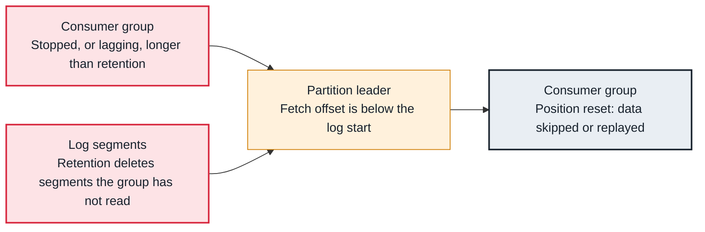

<!-- Generated from data/failures/consumer.js by `node scripts/atlas.mjs docs`. Edit the data, then regenerate. -->

# Offset out of range (data deleted before it was read)

A consumer's position points at data that no longer exists, usually because retention deleted it while the consumer was stopped or far behind. What happens next depends on auto.offset.reset.

| Kind | Layer | Scope | Interactive |
|---|---|---|---|
| Cause | Consumers | Any Kafka cluster | [Open in the atlas](../../index.html#/failures/offset-out-of-range) |

## How it propagates



## Symptom

Consumer logs say the fetch position 'is out of range for partition' and that the offset is being reset. With `auto.offset.reset=latest` the group silently jumps to the end and skips data; with `earliest` it replays what remains; with `none` it throws `OffsetOutOfRangeException`.

## Affected component

The **log**'s retention moved the start offset past the **consumer**'s committed offset; the **partition leader** rejects the fetch.

## Root cause

Retention is based on time or size and knows nothing about consumers. A group stopped longer than `retention.ms`, or lagging more than `retention.bytes` keeps, ends up pointing below the log start. Committed offsets of a group with no members also expire after `offsets.retention.minutes` (seven days by default), which leads to the same reset.

## Investigation

1. **Confirm the reset**

   ```sh
   grep -E 'out of range|resetting offset|OffsetOutOfRange' app.log | tail
   ```

   Look for: Which partitions, and where the position was reset to.

2. **Compare offsets with the log start**

   ```sh
   kafka-get-offsets.sh --bootstrap-server $BS --topic orders --time -2
   kafka-consumer-groups.sh --bootstrap-server $BS --describe --group billing
   ```

   Look for: An earliest offset above the group's CURRENT-OFFSET means data was deleted before it was read.

## Resolution

Decide whether to replay or skip, and reset deliberately while the group is stopped: `kafka-consumer-groups.sh --reset-offsets --to-datetime ... --execute`. Recover deleted data from its source system or a replica cluster. Then lengthen retention for that topic, or use tiered storage to keep more history cheaply.

## Prevention

- Set retention to cover the longest plausible consumer outage, with margin.
- Use auto.offset.reset=none for critical consumers, so a reset is an alert and not a silent skip.
- Alert when lag age approaches retention.

## Related

- [Consumer lag keeps growing](consumer-lag.md)

## Runbooks

- [Consumer lag](../runbooks/consumer-lag.md)

## Reproduce it locally

```sh
k kafka-topics.sh --bootstrap-server $BS --create --topic lab-short --partitions 1 --replication-factor 3 --config retention.ms=60000 --config segment.ms=10000
seq 1 1000 | k kafka-console-producer.sh --bootstrap-server $BS --topic lab-short
k kafka-console-consumer.sh --bootstrap-server $BS --topic lab-short --group lab-late --from-beginning --max-messages 10
# wait three minutes for retention, then read again and watch the reset
k kafka-console-consumer.sh --bootstrap-server $BS --topic lab-short --group lab-late --max-messages 1 --timeout-ms 10000
```

Start the lab cluster first: see [labs/](../../labs/README.md).
