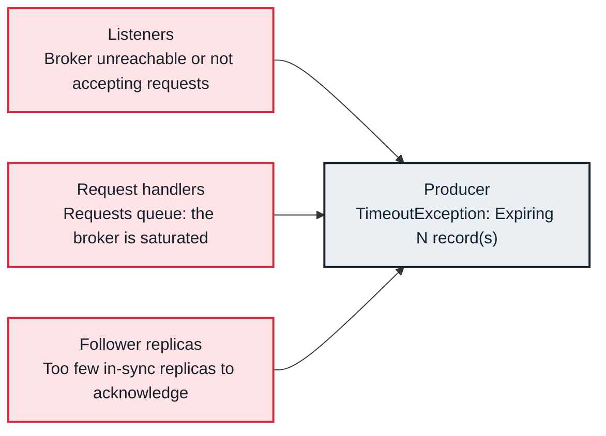

<!-- Generated from data/failures/producer.js by `node scripts/atlas.mjs docs`. Edit the data, then regenerate. -->

# Producer timeouts (records expire before they are acknowledged)

Records expire inside the producer before any broker acknowledges them: the leader is unreachable, overloaded, or cannot gather enough in-sync replicas in time.

| Kind | Layer | Scope | Interactive |
|---|---|---|---|
| Symptom | Producers | Any Kafka cluster | [Open in the atlas](../../index.html#/failures/producer-timeout) |

## How it propagates



## Symptom

Sends fail with `TimeoutException: Expiring N record(s) for <topic>-<partition>: ... ms has passed since batch creation`, often for a subset of partitions. Latency and buffer exhaustion come first; then `send()` itself may block for `max.block.ms`.

## Affected component

Reported by the **producer**, which is only the messenger. The cause sits with the partition's leader: its **listener** is unreachable, its **request handlers** are saturated, or with `acks=all` it waits for **followers** that do not keep up.

## Root cause

Every batch has `delivery.timeout.ms` (two minutes by default) to be acknowledged, retries included. Retries hide short failures; expiry means none succeeded in time. Which partitions expire tells you where to look: all of them points at the client or the network, partitions with one leader point at that broker.

## Investigation

1. **Which partitions, which leaders?**

   ```sh
   grep -oE 'Expiring [0-9]+ record\(s\) for [A-Za-z0-9._-]+-[0-9]+' app.log | sort | uniq -c | sort -rn | head
   kafka-topics.sh --bootstrap-server $BS --describe --topic orders
   ```

   Look for: If the expiring partitions share a leader, investigate that broker.

2. **Are those partitions healthy?**

   ```sh
   kafka-topics.sh --bootstrap-server $BS --describe --unavailable-partitions
   kafka-topics.sh --bootstrap-server $BS --describe --under-min-isr-partitions
   ```

   Look for: No leader, or an ISR below min.insync.replicas, explains acks=all writes that never complete.

3. **Can the client reach every broker?**

   ```sh
   kafka-broker-api-versions.sh --bootstrap-server $BS --command-config client.properties | grep -c '(id:'
   ```

   Look for: Fewer brokers than the cluster has, or a hang, points at connectivity.

## Resolution

Fix the leader-side cause: a broker that is down, saturated handlers, a lagging follower. On the client, keep `delivery.timeout.ms` longer than a failover, keep idempotence on so retries are safe, and make the application handle a failed send (retry later or divert) rather than drop it.

## Prevention

- Alert on producer record-error-rate and request-latency-max per service.
- Keep leadership balanced so one broker does not lead too much.
- Rehearse failover: stop a broker and confirm producers recover without errors.

## Related

- [NotEnoughReplicasException](not-enough-replicas.md)
- [Request handlers saturated](request-handler-saturation.md)
- [MSK brokers unreachable](broker-unreachable.md)
