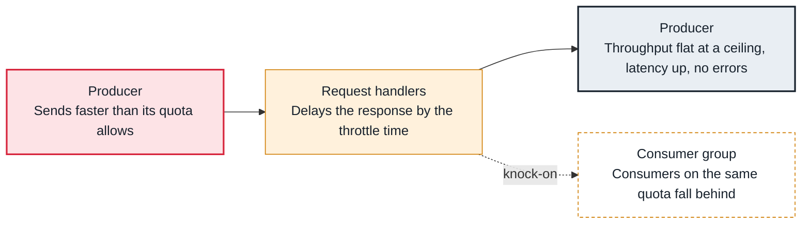

<!-- Generated from data/failures/producer.js by `node scripts/atlas.mjs docs`. Edit the data, then regenerate. -->

# Quota throttling (a client is slowed down on purpose)

A client exceeds its produce, fetch or request quota, and the broker slows it by delaying its responses.

| Kind | Layer | Scope | Interactive |
|---|---|---|---|
| Cause | Producers | Any Kafka cluster | [Open in the atlas](../../index.html#/failures/quota-throttling) |

## How it propagates



## Symptom

Throughput flattens at a fixed ceiling and latency rises, with no errors. The client metrics `produce-throttle-time-avg` or `fetch-throttle-time-avg` are above zero. A throttled consumer shows lag that never catches up.

## Affected component

The broker's **request handlers** apply quotas per user and client ID; the **producer** or **consumer** is slowed because its responses are held back.

## Root cause

Quotas are byte rates (`producer_byte_rate`, `consumer_byte_rate`) or a share of request time, set per user, per client ID or as a default. Over the limit, the broker computes a delay and mutes the connection for that long. A quota sized for normal traffic throttles a backfill or a replay.

## Investigation

1. **Is the client throttled?**

   ```sh
   # client metrics: produce-throttle-time-avg, fetch-throttle-time-avg
   # broker metrics: kafka.server:type=Produce,user=*,client-id=* throttle-time
   ```

   Look for: Throttle time above zero means quotas, not a broker failure.

2. **Read the quotas that apply**

   ```sh
   kafka-configs.sh --bootstrap-server $BS --describe --entity-type users --entity-type clients
   ```

   Look for: Default entries apply to every client without its own.

## Resolution

If the traffic is legitimate, raise the quota for that principal or client ID, for example `kafka-configs.sh --alter --add-config producer_byte_rate=20971520 --entity-type users --entity-name billing`. Run backfills under their own client ID and quota so they cannot starve production traffic.

## Prevention

- Give every service its own client.id and principal, so quotas and metrics are attributable.
- Alert on sustained throttle time, which otherwise looks like a slow cluster.
- Plan backfills with explicit quotas rather than removing limits.

## Related

- [Request handlers saturated](request-handler-saturation.md)
- [Consumer lag keeps growing](consumer-lag.md)

## Runbooks

- [Consumer lag](../runbooks/consumer-lag.md)
