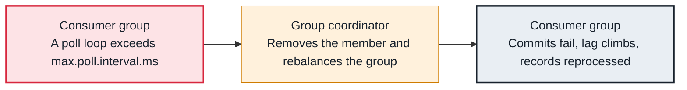

<!-- Generated from data/failures/consumer.js by `node scripts/atlas.mjs docs`. Edit the data, then regenerate. -->

# Rebalance storm (members keep leaving the group)

Members are removed again and again, most often because one poll loop took longer than max.poll.interval.ms, so the group spends its time rebalancing instead of consuming.

| Kind | Layer | Scope | Interactive |
|---|---|---|---|
| Cause | Consumers | Any Kafka cluster | [Open in the atlas](../../index.html#/failures/rebalance-storm) |

## How it propagates



## Symptom

Logs show members leaving and rejoining, `CommitFailedException`, or 'consumer poll timeout has expired'. Lag grows in waves and some records are processed twice. The group state keeps switching between Stable and PreparingRebalance.

## Affected component

The **consumer**'s poll loop triggers it; the **group coordinator** removes the member and rebalances the group (with cooperative assignment, only the partitions that move).

## Root cause

A member must call `poll()` again within `max.poll.interval.ms` (five minutes by default). If `max.poll.records` times the time per record exceeds that, the member is treated as dead, its partitions move, and its next commit fails. Each rebalance pauses consumption; with eager assignment it pauses the whole group. Rolling deploys add rebalances unless members use static membership.

## Investigation

1. **Confirm poll timeouts**

   ```sh
   grep -E 'poll timeout has expired|CommitFailedException|rebalanced' app.log | tail
   ```

   Look for: 'consumer poll timeout has expired' names the cause directly.

2. **Measure the loop**

   ```sh
   # consumer metrics: time-between-poll-max, last-poll-seconds-ago, rebalance-rate-per-hour
   ```

   Look for: time-between-poll-max close to max.poll.interval.ms (300000 ms).

3. **Watch the group**

   ```sh
   watch -n2 kafka-consumer-groups.sh --bootstrap-server $BS --describe --group billing --state
   ```

   Look for: Member count and state changing every few seconds.

## Resolution

Shorten each poll loop: lower `max.poll.records`, move slow work off the polling thread, or batch downstream calls. Raise `max.poll.interval.ms` only to the real worst case. Use the cooperative sticky assignor (or the consumer rebalance protocol, `group.protocol=consumer`, on Kafka 4.0 and later) so rebalances move only what changes, and static membership (`group.instance.id`) for rolling restarts.

## Prevention

- Alert on rebalance-rate-per-hour and on time-between-poll-max.
- Load test with the slowest realistic downstream latency.
- Commit in a rebalance listener before partitions are revoked, so reprocessing stays small.

## Related

- [Consumer lag keeps growing](consumer-lag.md)
- [Group coordinator not available](coordinator-not-available.md)

## Runbooks

- [Consumer lag](../runbooks/consumer-lag.md)
