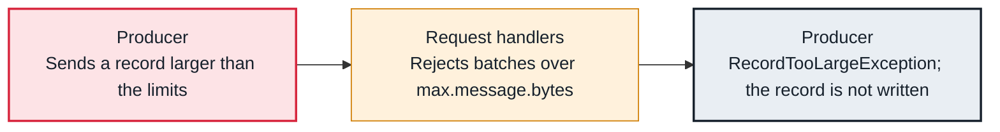

<!-- Generated from data/failures/producer.js by `node scripts/atlas.mjs docs`. Edit the data, then regenerate. -->

# RecordTooLargeException (a record exceeds a size limit)

A record or batch is bigger than a limit on its path: the producer's max.request.size, the broker's message.max.bytes, or the topic's max.message.bytes.

| Kind | Layer | Scope | Interactive |
|---|---|---|---|
| Cause | Producers | Any Kafka cluster | [Open in the atlas](../../index.html#/failures/record-too-large) |

## How it propagates



## Symptom

The send callback fails with `RecordTooLargeException`, or the broker answers `MESSAGE_TOO_LARGE` for the whole batch. Other records keep flowing, so throughput looks normal while specific large records disappear.

## Affected component

The **producer** checks `max.request.size` before sending. The broker's **request handlers** check `message.max.bytes`, which a topic can override with `max.message.bytes`. Consumers and followers also have fetch sizes, but those are soft limits: an oversized record still arrives.

## Root cause

Default limits are about 1 MB. The producer measures one serialized record; the broker measures a whole batch after compression. A payload that grows over time (an embedded document, a long list) crosses one of them. Raising only one limit moves the failure to the next one.

## Investigation

1. **Which limit was hit?**

   ```sh
   grep -E 'RecordTooLarge|MESSAGE_TOO_LARGE' app.log | tail -3
   ```

   Look for: 'when serialized ... max.request.size' is the producer; 'max message size the server will accept' is the broker.

2. **Read the broker and topic limits**

   ```sh
   kafka-configs.sh --bootstrap-server $BS --describe --entity-type topics --entity-name orders --all | grep max.message.bytes
   kafka-configs.sh --bootstrap-server $BS --describe --entity-type brokers --entity-name 1 --all | grep -E 'message.max.bytes|replica.fetch.max.bytes'
   ```

   Look for: The topic's max.message.bytes overrides the broker default.

## Resolution

Prefer small records: put large payloads in S3 and send a reference (the claim-check pattern), and compress (`compression.type=zstd`). If large records are legitimate, raise the limits together: producer `max.request.size`, topic `max.message.bytes`, and consumer `max.partition.fetch.bytes` and `fetch.max.bytes`.

## Prevention

- Agree a size budget per topic and test with the largest realistic payload.
- Alert on the producer metric record-error-rate, not only on broker health.
- Use the claim-check pattern for anything that can grow without bound.

## Related

- [Producer timeouts](producer-timeout.md)

## Reproduce it locally

```sh
k kafka-topics.sh --bootstrap-server $BS --create --topic lab-big --partitions 1 --replication-factor 3
head -c 1500000 /dev/zero | tr '\0' 'x' | k kafka-console-producer.sh --bootstrap-server $BS --topic lab-big
```

Start the lab cluster first: see [labs/](../../labs/README.md).
