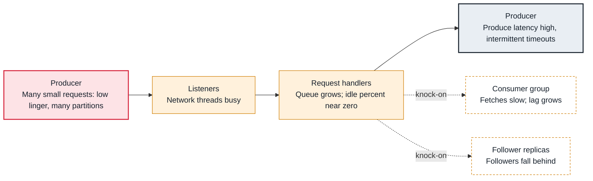

<!-- Generated from data/failures/broker.js by `node scripts/atlas.mjs docs`. Edit the data, then regenerate. -->

# Request handlers saturated (a broker is too busy)

A broker's I/O or network threads are busy all the time, so requests queue and every client of that broker sees high latency.

| Kind | Layer | Scope | Interactive |
|---|---|---|---|
| Cause | Brokers | Any Kafka cluster | [Open in the atlas](../../index.html#/failures/request-handler-saturation) |

## How it propagates



## Symptom

Request latency (`TotalTimeMs` for Produce and Fetch) rises on one or more brokers, `RequestHandlerAvgIdlePercent` drops below 0.3 and the request queue grows. Clients time out now and then; followers may leave the ISR.

## Affected component

The broker's **request handlers**, and often its **listeners**' network threads, are saturated; every **producer** and **consumer** talking to that broker slows down.

## Root cause

Every request costs thread time whatever its size, so many tiny requests (linger.ms=0, small batches, producers writing to thousands of partitions) exhaust the handlers. Expensive work makes it worse: converting message formats for old clients, TLS on small CPUs, or a disk that blocks appends. Unbalanced leadership concentrates the load on one broker.

## Investigation

1. **Which broker, which request?**

   ```sh
   # JMX per broker
   # kafka.server:type=KafkaRequestHandlerPool,name=RequestHandlerAvgIdlePercent
   # kafka.network:type=RequestMetrics,name=TotalTimeMs,request=Produce|FetchConsumer|FetchFollower
   ```

   Look for: Which request type and which part of the time (queue, local, remote) dominates.

2. **Is leadership balanced?**

   ```sh
   kafka-topics.sh --bootstrap-server $BS --describe | grep -oE 'Leader: [0-9]+' | sort | uniq -c
   ```

   Look for: One broker leading far more partitions than the others.

## Resolution

Send fewer, larger requests: raise producer `linger.ms` (5 to 20 ms) and `batch.size`, and consumer `fetch.min.bytes`. Rebalance leadership with `kafka-leader-election.sh --election-type preferred --all-topic-partitions`. If the load is real, add brokers or use larger ones, and raise `num.io.threads` and `num.network.threads` only when CPU has room.

## Prevention

- Alert on RequestHandlerAvgIdlePercent below 0.3 for 15 minutes.
- Ship producer batching settings in a shared client configuration.
- Keep leadership balanced (auto.leader.rebalance.enable=true).

Alerts that lead here: `KafkaRequestHandlersBusy` (ticket).

## Related

- [Producer timeouts](producer-timeout.md)
- [Consumer lag keeps growing](consumer-lag.md)
- [Broker throughput cap](broker-throughput-cap.md)

## Runbooks

- [Under-replicated partitions](../runbooks/under-replicated.md)
