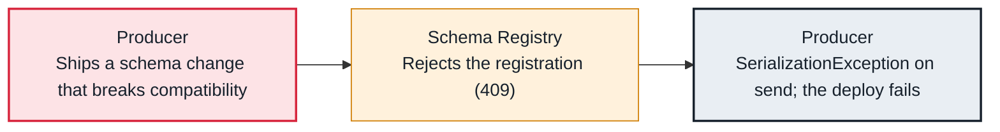

<!-- Generated from data/failures/platform.js by `node scripts/atlas.mjs docs`. Edit the data, then regenerate. -->

# Schema incompatible (the registry rejects a new version)

The Schema Registry refuses a new schema version because it breaks the subject's compatibility rule, so the producer cannot serialize the new record.

| Kind | Layer | Scope | Interactive |
|---|---|---|---|
| Cause | Platform | Any Kafka cluster | [Open in the atlas](../../index.html#/failures/schema-incompatible) |

## How it propagates



## Symptom

Producers fail on the first send of the new record type with `Schema being registered is incompatible with an earlier schema for subject "orders-value"` (HTTP 409), wrapped in a serialization exception. Old producers keep working.

## Affected component

The **Schema Registry** enforces the rule per subject; the **producer** with the new schema fails; the rule protects **consumers** that still read the old shape.

## Root cause

Under BACKWARD compatibility, consumers using the new schema must be able to read data written with the previous one: adding a field without a default, or changing a field's type, breaks that. FORWARD and FULL add the reverse direction. Registering schemas automatically at runtime turns a schema review into a production failure.

## Investigation

1. **Test the schema against the subject**

   ```sh
   curl -s -X POST -H 'Content-Type: application/vnd.schemaregistry.v1+json' --data @new-schema.json "$SR/compatibility/subjects/orders-value/versions/latest?verbose=true"
   ```

   Look for: is_compatible false, and the messages naming the breaking fields.

2. **Which rule applies?**

   ```sh
   curl -s $SR/config/orders-value
   curl -s $SR/config
   ```

   Look for: The subject's compatibility level, or the global default.

## Resolution

Make the change compatible: give new fields defaults, add instead of renaming, deprecate instead of deleting where FORWARD applies. For a truly breaking change, write to a new topic or subject and migrate consumers. Do not set compatibility to NONE to force a change through.

## Prevention

- Check compatibility in CI against the production registry before deploying.
- Turn off auto.register.schemas in production producers; register through the pipeline.
- Record the compatibility level of every subject.

## Related

- [Deserialization error](deserialization-error.md)
