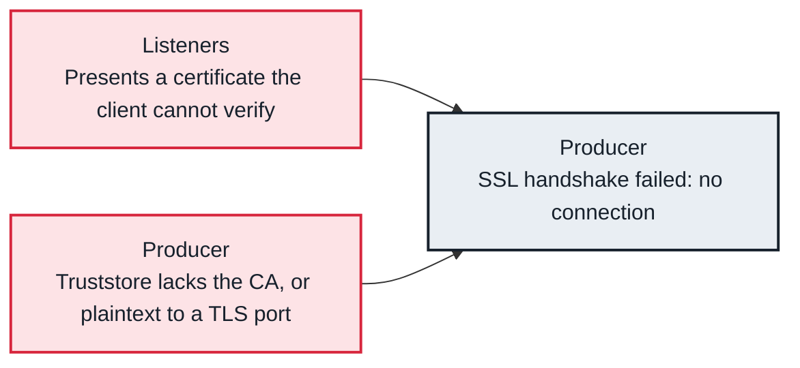

<!-- Generated from data/failures/connectivity.js by `node scripts/atlas.mjs docs`. Edit the data, then regenerate. -->

# TLS handshake failed

The TLS handshake between client and broker fails: the client does not trust the certificate authority, the hostname does not match, or one side speaks plaintext to a TLS port.

| Kind | Layer | Scope | Interactive |
|---|---|---|---|
| Cause | Connectivity | Any Kafka cluster | [Open in the atlas](../../index.html#/failures/tls-handshake-failed) |

## How it propagates



## Symptom

Clients fail with `SslAuthenticationException: SSL handshake failed`, caused by `PKIX path building failed` or 'No subject alternative names matching'. A client configured for plaintext on a TLS port sees disconnects and timeouts instead.

## Affected component

The broker **listener**'s certificate, and the client's (**producer**, **admin**) truststore and hostname verification.

## Root cause

Clients check the broker certificate against their truststore and, by default (`ssl.endpoint.identification.algorithm=https`), that it names the host they connected to. A private CA missing from the truststore, an expired certificate, brokers advertised by IP while certificates name hosts, or client certificates signed by a CA the broker does not trust all fail the handshake.

## Investigation

1. **Inspect the broker certificate**

   ```sh
   openssl s_client -connect kafka-1.internal:9094 -servername kafka-1.internal </dev/null 2>/dev/null | openssl x509 -noout -subject -issuer -dates -ext subjectAltName
   ```

   Look for: Issuer, expiry dates, and names that match the advertised hostname.

2. **Check the client settings**

   ```sh
   grep -E 'security.protocol|ssl\.' client.properties
   ```

   Look for: SSL or SASL_SSL, and a truststore containing the issuer.

## Resolution

Add the issuing CA to the client truststore. MSK's broker certificates are publicly trusted; private CA certificates for mutual TLS must be added on both sides. Match `security.protocol` to the port, renew expired certificates, and keep advertised hostnames consistent with the certificates' names.

## Prevention

- Alert on certificate expiry 30 days ahead.
- Build truststores into client images, not by hand.
- Keep hostname verification on; fix names instead of disabling it.

## Related

- [SASL authentication failed](authentication-failed.md)
- [MSK brokers unreachable](broker-unreachable.md)

## Runbooks

- [Clients cannot connect](../runbooks/client-connectivity.md)
