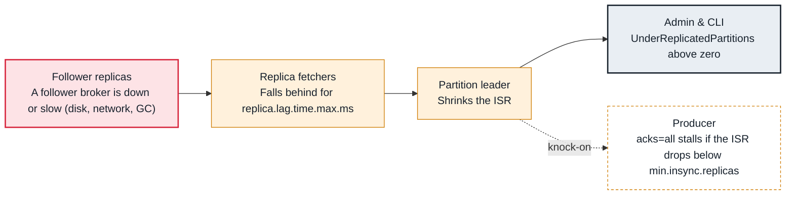

<!-- Generated from data/failures/replication.js by `node scripts/atlas.mjs docs`. Edit the data, then regenerate. -->

# Under-replicated partitions

Some partitions have fewer in-sync replicas than replicas: a follower broker is down, slow, or cannot keep up, and durability is reduced until it catches up.

| Kind | Layer | Scope | Interactive |
|---|---|---|---|
| Symptom | Replication | Any Kafka cluster | [Open in the atlas](../../index.html#/failures/under-replicated-partitions) |

## How it propagates



## Symptom

The `UnderReplicatedPartitions` metric is above zero, and `kafka-topics --describe --under-replicated-partitions` lists partitions whose Isr is shorter than Replicas. Broker logs show 'Shrinking ISR'. Often every affected partition shares one broker.

## Affected component

The **leader** shrinks the ISR when a **follower**'s **replica fetcher** has not caught up within `replica.lag.time.max.ms`. The broker missing from the ISRs is the one to investigate; its **disk** is a common culprit.

## Root cause

A follower stays in sync only while it keeps fetching up to the leader's log end within 30 seconds. A stopped broker, a saturated disk, a network limit, long garbage collection pauses or a large reassignment make it fall behind. Durability drops: with replication factor 3 and one follower out, one more failure leaves a single copy.

## Investigation

1. **Which broker is missing?**

   ```sh
   kafka-topics.sh --bootstrap-server $BS --describe --under-replicated-partitions
   ```

   Look for: The broker ID that is in Replicas but missing from Isr on most lines.

2. **Is that broker registered and current?**

   ```sh
   kafka-metadata-quorum.sh --bootstrap-server $BS describe --replication
   ```

   Look for: Brokers appear as observers; a missing one, or one with large lag, is the suspect.

3. **Is it slow?**

   ```sh
   # on that broker
   iostat -x 5 3
   grep -E 'Shrinking ISR|Expanding ISR' /var/log/kafka/server.log | tail
   ```

   Look for: Disk utilization near 100%, high await, or the ISR shrinking and expanding repeatedly.

## Resolution

Bring the broker back or remove its bottleneck (disk throughput, network, garbage collection). If a reassignment is running, throttle it (`kafka-reassign-partitions.sh --additional --throttle`). Partitions recover by themselves once the follower catches up; watch the count fall to zero.

## Prevention

- Alert when UnderReplicatedPartitions stays above zero for 5 minutes, per broker.
- Size broker disk and network for ingress times the replication factor, plus room to catch up.
- Throttle every reassignment and broker replacement.

## Related

- [NotEnoughReplicasException](not-enough-replicas.md)
- [Broker disk full](disk-full.md)
- [Broker throughput cap](broker-throughput-cap.md)

## Runbooks

- [Under-replicated partitions](../runbooks/under-replicated.md)
- [Rolling restart or upgrade](../runbooks/rolling-restart.md)

## Reproduce it locally

```sh
k kafka-topics.sh --bootstrap-server $BS --create --topic lab-urp --partitions 6 --replication-factor 3
docker compose -f labs/compose.yaml stop kafka-3
k kafka-topics.sh --bootstrap-server $BS --describe --under-replicated-partitions
docker compose -f labs/compose.yaml start kafka-3
```

Start the lab cluster first: see [labs/](../../labs/README.md).
