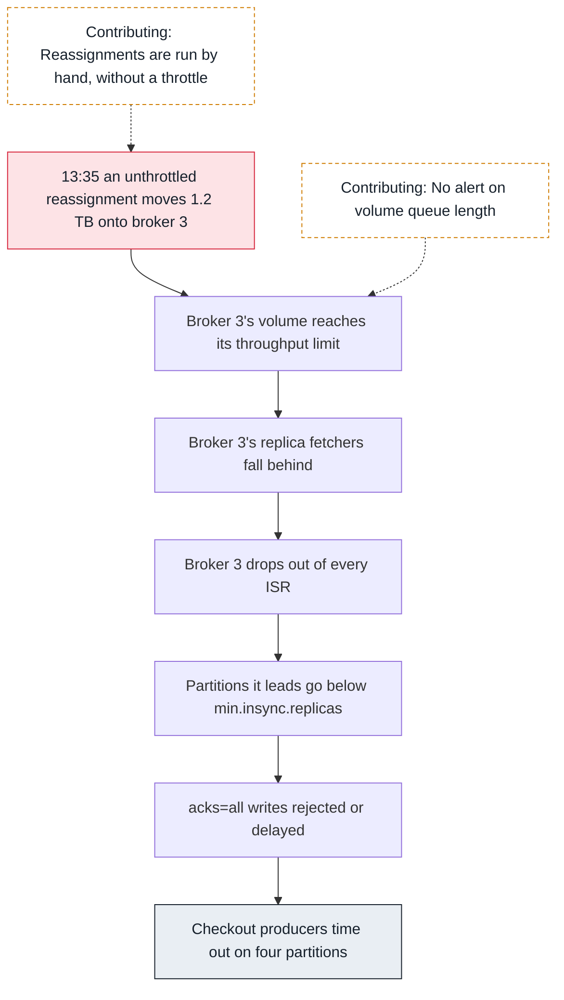
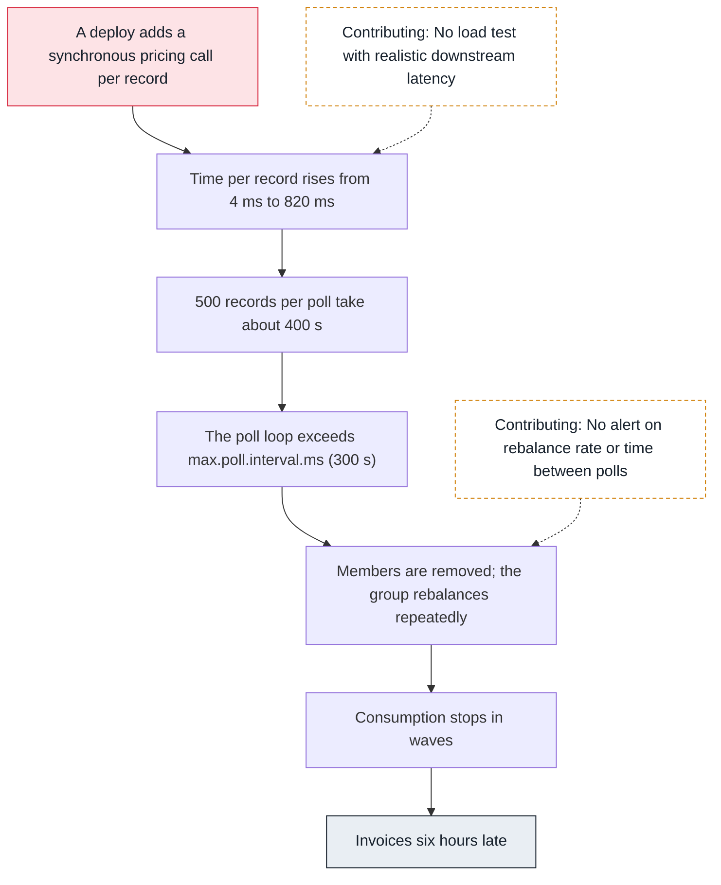
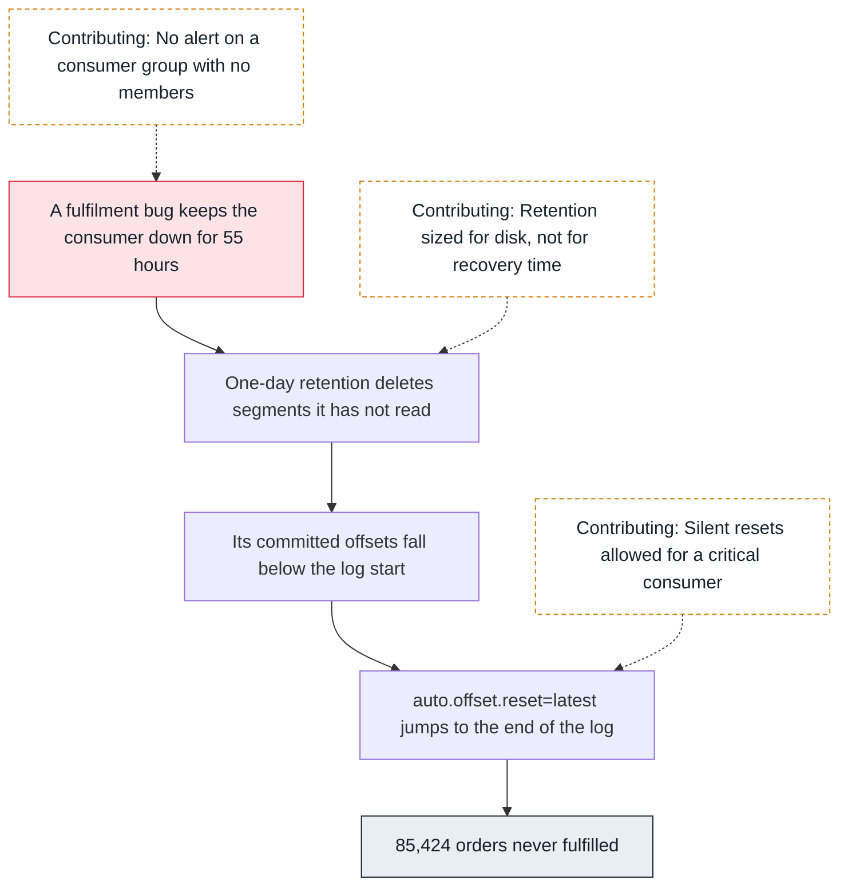

<!-- Generated from data/incidents.js by `node scripts/atlas.mjs docs`. Edit the data, then regenerate. -->

# Incidents

Each investigation starts from what someone noticed and follows dependencies, one hop at a time, until it reaches the change that caused it. [Replay them on the map](../index.html#/incidents).

## Checkout stalled behind one slow broker

SEV2, Wednesday 13:52, eu-west-1. Checkout producers time out on four partitions of the orders topic. Orders are still accepted, but slowly, and some are retried by customers.

### Hop 1: Start where it hurts (Producer)

```sh
grep -oE 'Expiring [0-9]+ record\(s\) for orders-[0-9]+' checkout.log | sort | uniq -c | sort -rn | head -4
```

```text
  412 Expiring 25 record(s) for orders-2
  398 Expiring 25 record(s) for orders-5
  377 Expiring 25 record(s) for orders-8
  351 Expiring 25 record(s) for orders-11
```

Only partitions 2, 5, 8 and 11 expire: a pattern, not the whole topic. Next hop: who leads them.

### Hop 2: Who leads those partitions? (Brokers)

```sh
kafka-topics.sh --bootstrap-server $BS --describe --topic orders | grep -E 'Partition: (2|5|8|11)\s'
```

```text
Partition: 2   Leader: 1  Replicas: 1,3,2  Isr: 1,2
Partition: 5   Leader: 3  Replicas: 3,2,1  Isr: 3
Partition: 8   Leader: 2  Replicas: 2,3,1  Isr: 2,1
Partition: 11  Leader: 3  Replicas: 3,1,2  Isr: 3
```

Broker 3 has dropped out of every ISR it belongs to. Partitions it leads have no in-sync follower, so with min.insync.replicas=2 they reject writes; the others stall each time broker 3 rejoins and falls behind again.

### Hop 3: What does broker 3 look like? (CloudWatch)

```sh
# CloudWatch AWS/Kafka, Broker ID 3, last 3 hours:
# VolumeWriteBytes, VolumeQueueLength, BytesInPerSec, CpuUser
```

```text
VolumeWriteBytes   flat at about 250 MB/s since 13:40
VolumeQueueLength  2 -> 31
BytesInPerSec      unchanged
CpuUser            34%
```

The volume sits at a throughput ceiling while client traffic is unchanged: something else is writing to it.

### Hop 4: What else is using the volume? (EBS volumes)

```sh
kafka-reassign-partitions.sh --bootstrap-server $BS --list
```

```text
Current partition reassignments:
events-0: replicas: 3,1,2. adding: 3. removing: 4.
events-1: replicas: 3,2,1. adding: 3. removing: 5.
events-2: replicas: 3,1,2. adding: 3. removing: 6.
```

At 13:35 someone started moving 1.2 TB of the events topic onto broker 3 without a replication throttle. The copy saturates its volume and starves its normal replication.

### Hop 5: Mitigate: throttle the move (Brokers)

```sh
kafka-reassign-partitions.sh --bootstrap-server $BS --execute --reassignment-json-file move-events.json \
  --additional --throttle 50000000
```

```text
The inter-broker throttle limit was set to 50000000 B/s
Warning: You must run --verify periodically, until the reassignment completes, to ensure the throttle is removed.
```

Within four minutes broker 3 rejoined every ISR and the producer errors stopped. The move finished overnight.

**Root cause.** An unthrottled partition reassignment onto broker 3 saturated its EBS volume. Broker 3 fell out of every ISR; the partitions it led dropped below min.insync.replicas and rejected acks=all writes, and the others stalled as it rejoined and fell behind again.



- **Mitigate:** Throttle the running reassignment to 50 MB/s.
- **Fix:** Run reassignments through a tool that throttles and batches them.
- **Prevent:** Alert on VolumeQueueLength and UnderMinIsrPartitionCount per broker.

## Billing fell six hours behind after a deploy

SEV3, Monday 05:10, eu-west-1. Invoices for Sunday's orders are six hours late. The billing service is running and its logs show no errors, only warnings.

### Hop 1: Lag in waves (Consumer group)

```sh
kafka-consumer-groups.sh --bootstrap-server $BS --describe --group billing
```

```text
TOPIC   PARTITION  CURRENT-OFFSET  LOG-END-OFFSET  LAG      CONSUMER-ID
orders  0          51180022        51932811        752789   -
orders  1          51177409        51941002        763593   -
...
```

Lag on every partition, and no CONSUMER-ID: at this moment the group has no assigned members.

### Hop 2: Is the group stable? (Group coordinator)

```sh
for i in 1 2 3 4 5; do kafka-consumer-groups.sh --bootstrap-server $BS --describe --group billing --state | tail -1; sleep 20; done
```

```text
billing  b-2:9092 (2)  cooperative-sticky  PreparingRebalance   6
billing  b-2:9092 (2)  cooperative-sticky  Stable               6
billing  b-2:9092 (2)  cooperative-sticky  PreparingRebalance   5
billing  b-2:9092 (2)  cooperative-sticky  CompletingRebalance  6
billing  b-2:9092 (2)  cooperative-sticky  PreparingRebalance   6
```

The group spends most of its time rebalancing.

### Hop 3: Why do members leave? (Consumer group)

```sh
grep -c 'poll timeout has expired' billing-*.log
```

```text
billing-0.log:19
billing-1.log:21
billing-2.log:17
```

Members are removed for exceeding max.poll.interval.ms (300 s).

### Hop 4: What changed in the loop? (Consumer group)

```sh
git log --oneline -1 -- src/billing/InvoiceHandler.java
# processing time per record, p99, from the service's own metrics
```

```text
a41c9e2 Enrich invoices with tax rates from the pricing API
p99 per record: 4 ms -> 820 ms
```

Friday's deploy added a synchronous HTTP call per record. 500 records per poll at 0.8 s each is 400 s, longer than the 300 s poll interval.

### Hop 5: Mitigate (Consumer group)

```sh
# billing consumer settings
max.poll.records=50
# then cache tax rates per region (deployed 07:20)
```

```text
lag: 6.1 h -> 0 in 48 minutes
rebalance-rate-per-hour: 41 -> 0
```

Smaller batches stopped the timeouts at once; the cache removed the slow call.

**Root cause.** A deploy added a slow synchronous call per record. With the default max.poll.records of 500, one poll loop took longer than max.poll.interval.ms, so members were removed, rebalances stopped the group again and again, and lag grew for six hours.



- **Mitigate:** Lower max.poll.records to 50.
- **Fix:** Cache tax rates, and call the pricing API per batch, not per record.
- **Prevent:** Alert when time-between-poll-max passes 60% of max.poll.interval.ms.

## Orders skipped after a long consumer outage

SEV2, Monday 09:30, eu-west-1. The nightly reconciliation finds 85,424 orders that were created but never fulfilled, all from one weekend window.

### Hop 1: A reconciliation gap (Admin & CLI)

```sh
# nightly reconciliation report
```

```text
orders created: 1,284,401   fulfilled or cancelled: 1,198,977
unaccounted: 85,424 (created between Saturday 02:10 and Sunday 09:12)
```

A block of orders never reached fulfilment, all from one time window.

### Hop 2: Did fulfilment read them? (Consumer group)

```sh
grep -E 'out of range|resetting offset' fulfilment-*.log | head -2
```

```text
Fetch position FetchPosition{offset=88120334, ...} is out of range for partition orders-4, resetting offset
(one line per partition, Monday 09:12)
```

When fulfilment restarted on Monday, its committed offsets pointed at data that no longer existed.

### Hop 3: What does the log keep? (Log segments)

```sh
kafka-configs.sh --bootstrap-server $BS --describe --entity-type topics --entity-name orders | grep retention
kafka-get-offsets.sh --bootstrap-server $BS --topic orders --time -2 | head -2
```

```text
retention.ms=86400000
orders:0:88904410
orders:1:88902117
```

Retention is one day. Fulfilment was down for 55 hours with a bug, so the log start passed its committed offsets.

### Hop 4: Why was nothing replayed? (Consumer group)

```sh
grep auto.offset.reset fulfilment.properties
```

```text
auto.offset.reset=latest
```

With latest, the reset jumped to the end of the log: everything between the deletion point and the restart was skipped silently.

### Hop 5: Recover (Producer)

```sh
# re-publish the missing window from the orders database
./republish-orders --from 2026-10-03T02:10Z --to 2026-10-04T09:12Z --topic orders-replay
```

```text
republished 85,424 orders
```

Fulfilment consumed the replay topic; customers received those orders a day late.

**Root cause.** Fulfilment was down for 55 hours, longer than the orders topic's one-day retention. When it restarted, its committed offsets had been deleted, and auto.offset.reset=latest moved it silently to the end of the log, skipping 85,424 orders.



- **Mitigate:** Re-publish the missing window from the source database.
- **Fix:** Seven days of retention for orders, using tiered storage.
- **Prevent:** auto.offset.reset=none for critical consumers, and an alert on groups without members.
